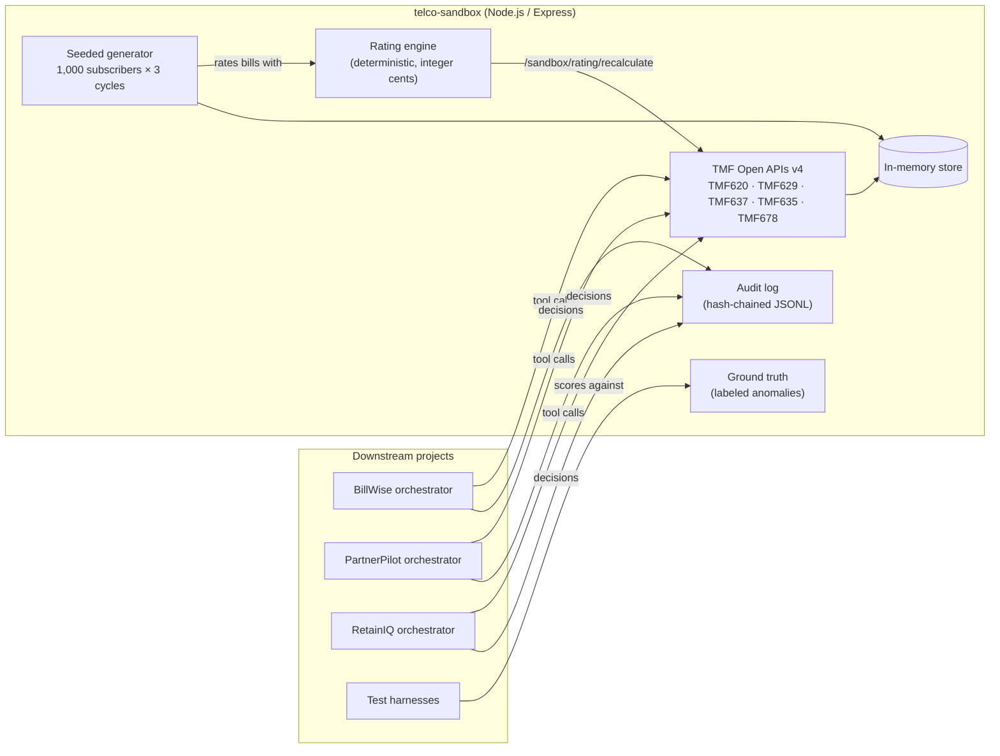

# telco-sandbox

A mock telco BSS (business support system) that serves TM Forum Open APIs over synthetic customers, usage and bills, with a deterministic rating engine and labeled bill-shock anomalies. It is the shared foundation for three AI projects:

- **BillWise**: a bill dispute agent
- **PartnerPilot**: an MVNO wholesale partner integration copilot
- **RetainIQ**: churn prediction with agent-driven retention

> **All data in this repository is synthetic.** It is generated from a random seed. No employer or operator data, documents, names or internal system details are used. Names are drawn from generic lists, emails use `example.com` and phone numbers use the fictional `555` exchange.

## Problem

AI agents for telecom billing and care can't be built or tested without a BSS to call, and real BSS data is off-limits. Agents also need ground truth: to score "did the agent find why this bill went up?", something has to know the right answer. This repo provides both. It exposes a realistic, standards-shaped BSS and plants known, labeled causes of bill shock.

## Architecture



The generator builds the dataset at startup from a seed and rates every bill with the same engine that agents call as a tool. Downstream orchestrators read BSS data through the TMF endpoints, call the rating engine for any number they need, and write each decision to the audit log.

## Demo

```bash
npm install
npm start                       # http://localhost:3000, seed 42, 1,000 subscribers
```

```bash
# A customer whose August bill has a duplicated add-on charge
curl "http://localhost:3000/tmf-api/customerBillManagement/v4/appliedCustomerBillingRate?bill.id=BILL-000006-202608&fields=name,taxExcludedAmount"

# Re-rate it: the engine reports a $10.75 discrepancy (the $10 duplicate plus 7.5% tax)
curl -X POST http://localhost:3000/sandbox/rating/recalculate \
  -H "content-type: application/json" -d '{"customerId":"CUST-000006","cycle":"2026-08"}'

# The answer key
curl "http://localhost:3000/sandbox/ground-truth/anomalies?customerId=CUST-000006"
```

On Windows PowerShell, use `curl.exe` (not the `curl` alias) or `Invoke-RestMethod`:

```powershell
Invoke-RestMethod -Method Post http://localhost:3000/sandbox/rating/recalculate `
  -ContentType "application/json" -Body '{"customerId":"CUST-000006","cycle":"2026-08"}'
```

A recorded walkthrough will be added once BillWise is calling these endpoints.

### Endpoints

| API | Path | Notes |
| --- | --- | --- |
| TMF620 Product Catalog | `GET /tmf-api/productCatalogManagement/v4/productOffering[/{id}]` | 7 plans, 4 add-ons, roam day pass, promo. Filter `category.id=plan\|addon\|pass\|promo` |
| TMF629 Customer | `GET /tmf-api/customerManagement/v4/customer[/{id}]` | Filters `segment`, `taxRegion` |
| TMF637 Product Inventory | `GET /tmf-api/productInventory/v4/product[/{id}]` | Filters `relatedParty.id`, `status`, `productOffering.id` |
| TMF635 Usage | `GET /tmf-api/usageManagement/v4/usage[/{id}]` | Requires `relatedParty.id`. Filters `usageDate.gte/.gt/.lte/.lt`, `usageType` |
| TMF678 Customer Bill | `GET /tmf-api/customerBillManagement/v4/customerBill[/{id}]` | Filters `relatedParty.id`, `state`, `billDate.*` |
| TMF678 Bill lines | `GET /tmf-api/customerBillManagement/v4/appliedCustomerBillingRate?bill.id=` | One rate per bill line, including tax |
| Rating tool | `POST /sandbox/rating/recalculate` | Body `{ customerId, cycle }`. Re-rated lines plus discrepancy versus the bill |
| Audit log | `POST /sandbox/audit/events`, `GET /sandbox/audit/events`, `GET /sandbox/audit/verify` | See [ADR 0004](docs/adr/0004-hash-chained-audit-log.md) |
| Ground truth | `GET /sandbox/ground-truth/anomalies` | Filters `type`, `customerId`, `cycle`. Off when `EXPOSE_GROUND_TRUTH=false` |
| Meta | `GET /sandbox/meta`, `GET /health` | Seed, size, counts |

All list endpoints support `offset`, `limit` (max 1,000) and `fields`, and return `X-Total-Count` and `X-Result-Count`.

### The dataset

Seed 42, 1,000 subscribers, billing cycles July to September 2026:

| | Count |
| --- | --- |
| Customers (10% business) | 1,000 |
| Inventory products | 2,121 |
| Usage records (data, voice, SMS, roaming) | 167,229 |
| Bills / bill lines | 3,000 / 9,373 |
| Labeled anomalies | 261 |

| Planted anomaly | Count | Billing error? | What the agent should find |
| --- | --- | --- | --- |
| `MID_CYCLE_PLAN_CHANGE` | 35 | No | Two prorated plan lines after an upgrade |
| `PROMO_EXPIRED` | 27 | No | The $10 discount line from last month is gone |
| `ROAMING_DAY_PASS` | 47 | No | $12 per calendar day with roaming usage |
| `DATA_OVERAGE` | 22 | No | $10 per started GB over the plan allowance |
| `DUPLICATE_RECURRING_CHARGE` | 38 | **Yes** | An add-on charged twice; credit equals line plus tax |
| `TAX_CHANGE` | 92 | No | Northgate sales tax rose from 6.5% to 9% in September |

`npm run generate` writes the full dataset to `data/generated/*.json` for notebooks and other repos. Set `SANDBOX_SEED` and `SANDBOX_SUBSCRIBERS` to vary it (see `.env.example`).

## Design decisions

| Decision | Trade-off | ADR |
| --- | --- | --- |
| Shape the BSS as TM Forum Open APIs | More mapping code than a home-grown schema, but agent tools port to a real TMF-compliant BSS | [0001](docs/adr/0001-tm-forum-open-apis.md) |
| A deterministic rating engine computes every charge; the LLM never does | Agents can't "reason" about amounts, but every number they quote is correct and defects are found by re-rating | [0002](docs/adr/0002-deterministic-rating-engine.md) |
| Seeded generator with one labeled cause per affected customer | Easier than real-world multi-cause bills, but gives clean, reproducible ground truth | [0003](docs/adr/0003-seeded-synthetic-data-with-labels.md) |
| Hash-chained audit log hosted by the sandbox | Couples projects to the sandbox at runtime, but gives one consistent, tamper-evident decision record | [0004](docs/adr/0004-hash-chained-audit-log.md) |
| Generate in memory at startup instead of committing data | About 0.4 s startup cost, but no 27 MB of JSON in git and the seed is the single source of truth | [0003](docs/adr/0003-seeded-synthetic-data-with-labels.md) |

## Test results

`npm test` runs on Node 20 and 22 in GitHub Actions on every push and pull request.

| Suite | Tests | What it proves | Result |
| --- | --- | --- | --- |
| Rating engine | 8 | Proration, promo coverage, overage per started GB, roaming per day, effective-dated tax, rounding | 8 / 8 pass |
| Generator and ground truth | 8 | Determinism; bills equal the sum of lines; each label explains its bill delta; unlabeled bills never change; re-rating finds exactly the labeled credit on every one of 1,200 bills | 8 / 8 pass |
| TMF API | 9 | Resource shapes, paging headers, `fields`, filters, errors, recalculate tool, audit chaining, ground-truth switch | 9 / 9 pass |
| Audit log | 2 | Tampering is detected; the chain survives a reload from disk | 2 / 2 pass |
| **Total** | **27** | | **27 / 27 pass** |

The sandbox's accuracy gate is the ground-truth suite: if a change to the generator or rating engine makes any label wrong, CI fails, so downstream accuracy numbers stay trustworthy.

## Cost per transaction

$0. The sandbox makes no LLM or paid API calls. Cost per resolution is measured in each downstream project.

## Limitations

- Read-only TMF subset; not a conformance-tested implementation. Deviations are listed in [ADR 0001](docs/adr/0001-tm-forum-open-apis.md).
- One bill-shock cause per customer, and anomalies are planted only in August and September.
- Simplified rating: one sales-tax rate per bill, overage measured against the plan active at cycle end, voice and SMS always unlimited.
- Single-line accounts; no family plans, devices, payments or collections.
- In-memory store; data resets on restart (the audit log persists to `logs/audit.jsonl`).
- The audit log is tamper-evident, not tamper-proof.

## Roadmap

- Multi-cause and distractor cases (for example, a promo expiring in the same month as roaming)
- Wholesale partner data for PartnerPilot: MVNO accounts, activation and port-in events, a partner API spec
- Churn signals for RetainIQ: tenure, support contacts, contract type, consent and opt-out flags
- Expose the sandbox as an MCP server so any agent can use it as tools
- Write operations (`POST` adjustments via TMF678) with approval states
- OpenAPI document for the subset, validated in CI

## Project layout

```
src/
  app.js, server.js          Express app and entry point
  data/catalog.js            Fictional plans, add-ons, promos, tax regions
  data/generator.js          Seeded dataset and anomaly labels
  data/store.js              In-memory indexes
  rating/engine.js           Deterministic rating
  routes/bss.js, tmf.js      TMF endpoints and resource mappers
  routes/sandbox.js          Rating tool, audit log, ground truth
  audit/auditLog.js          Hash-chained JSONL log
scripts/generate.js          Export dataset to data/generated/
test/                        node:test suites
docs/adr/                    Architecture decision records
```
